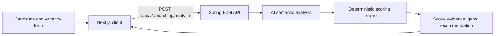

# OfferFit — Hybrid Job Match Analyzer

> A full-stack ATS prototype that combines AI-assisted semantic analysis with a transparent, deterministic scoring engine.


## Overview

OfferFit compares a candidate profile with a job description. The frontend collects structured education, experience, skills, and vacancy information. The backend requests semantic evidence from an AI service, then applies explicit weights to skills, experience, education, keywords, and working conditions.

The hybrid design keeps the final score inspectable instead of delegating the whole decision to a language model.



## Scoring model

| Component | Weight |
|---|---:|
| Skills | 40% |
| Experience | 30% |
| Keywords | 15% |
| Education | 10% |
| Conditions | 5% |

The API returns the total compatibility score together with the full contribution breakdown, matched and missing requirements, strengths, weaknesses, and processing time.

## Stack

- **Frontend:** Next.js, React, TypeScript, Tailwind CSS, React Hook Form, Zustand
- **Backend:** Java 17, Spring Boot, Bean Validation, WebClient, Jackson
- **AI layer:** configurable external semantic-analysis endpoint
- **Research assets:** an additional Python model experiment and training/validation data under `ML model/`

## Run locally

### Backend

```bash
cd backend
mvn spring-boot:run
```

Review `backend/src/main/resources/application.yml` and provide the configured AI-service settings before calling the analysis endpoint. Health check: `GET http://localhost:8080/api/v1/matching/health`.

### Frontend

```bash
cd Frontend
npm install
npm run dev
```

Open `http://localhost:3000`.

## Interface


## Responsible use

OfferFit is a portfolio prototype, not an autonomous hiring decision-maker. Candidate ranking can create legal and fairness risks; any real use would require validated job-related criteria, bias testing, privacy controls, explainability, and human review.
